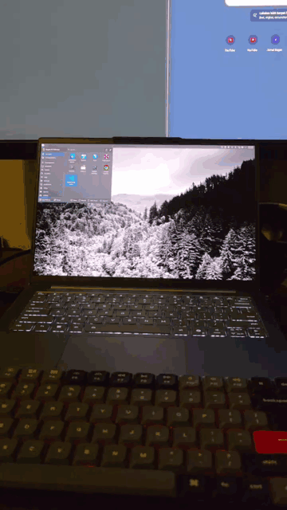

# Cerita

Laptop yang saya pakai sehari-hari dual-boot antara Windows dan openSUSE Leap 16.1. Di Windows, untuk login saya cukup menatap kamera lewat Windows Hello. Tapi begitu pindah ke openSUSE, saya harus kembali mengetik password, termasuk setiap kali menjalankan `sudo`. Dari situ saya penasaran, apakah di Linux juga bisa login menggunakan wajah seperti di Windows? Jawabannya, bisa, yaitu dengan Howdy.

Pada kesempatan kali ini saya ingin membagikan cerita dan langkah-langkah saya memasang Howdy di openSUSE sampai akhirnya berhasil. Sekarang `sudo`, lock screen KDE, dan layar login SDDM dapat terbuka dengan wajah, dan lampu IR-nya berkedip persis seperti di Windows. Tapi ternyata jalannya tidak sesederhana "install Howdy, lalu selesai". Ada emitter IR yang tidak mau menyala, kamera yang hang, alat yang mengaku berhasil padahal tidak, dan SELinux yang diam-diam memblokir layar login.

Saya juga akan menceritakan jalan buntu yang sempat saya lalui, karena justru dari situ saya banyak belajar. Oke, mari kita mulai.

# Mengenali Kamera IR

Hal pertama yang perlu kita ketahui, Windows Hello membutuhkan kamera inframerah (IR). Di laptop saya, kamera RGB dan kamera IR ternyata berada dalam satu modul USB yang sama, yaitu Luxvisions (`30c9:011a`). Modul tersebut muncul sebagai empat node video seperti pada tabel berikut:

| Node | Isi |
|---|---|
| `/dev/video0` | Kamera RGB biasa (MJPG, sampai 1080p) |
| `/dev/video1` | Metadata RGB |
| `/dev/video2` | **Kamera IR** (GREY 8-bit, 640x360) |
| `/dev/video3` | Metadata IR |

Untuk memastikan node mana yang merupakan kamera IR, kita dapat menjalankan `v4l2-ctl --list-formats-ext` pada setiap node. Node yang memiliki format `GREY` adalah kamera IR. Lalu karena nomor `/dev/videoN` bisa berubah setelah reboot, sebaiknya kita menggunakan path yang tetap, yaitu `/dev/v4l/by-path/...-1.2-video-index0`.

Dari sini masalah pertama langsung kelihatan. Frame yang dihasilkan kamera IR hampir hitam semua, dengan rata-rata kecerahan sekitar 3 dari 255. Artinya lampu IR atau emitter-nya tidak menyala. Di Windows, driver yang bertugas menyalakan emitter tersebut, sedangkan di Linux tidak ada yang melakukannya.

# Jalan Buntu: linux-enable-ir-emitter

Tool yang paling sering direkomendasikan untuk masalah ini adalah [linux-enable-ir-emitter](https://github.com/EmixamPP/linux-enable-ir-emitter). Cara kerjanya, tool ini akan mencoba test kamera satu per satu, terus bertanya kepada kita apakah emitter-nya berkedip atau tidak. Sayangnya di kamera saya prosesnya nggak berjalan mulus, ada beberapa kendala yang saya temui:

1. **Kamera hang.** Saat testing awal control `unit 4 / selector 2` gagal di-reset, lalu `selector 3` membuat kamera berhenti merespons sama sekali. Satu-satunya cara memulihkannya adalah shutdown penuh, bukan sekadar restart. Solusinya, kita tandai kontrol tersebut sebagai `disable` di file config alat ini, shutdown, lalu ulangi lagi.
2. **Jendela preview tidak muncul.** Tool ini membuka jendela GTK, sedangkan `sudo` tidak meneruskan akses ke display. Jadi kita perlu menjalankannya dengan `sudo env DISPLAY=$DISPLAY XAUTHORITY=$XAUTHORITY ...`. Selain itu, jawaban Y/N ternyata harus ditekan di jendela preview, bukan di terminal.
3. **"Berhasil" saya ngeliat IR blinking, padahal tidak.** Setelah mencoba belasan control, alat ini menyimpulkan bahwa `unit 7 / selector 9` adalah jawabannya. Belakangan baru ketahuan kalau itu false positive, karena mengubah kontrol tersebut sama sekali tidak memengaruhi kecerahan frame.

# Kunci: Switch Punya Windows Hello Sendiri

Setelah buntu dengan cara coba-coba tadi, saya mencoba melihat langsung deskriptor USB kameranya menggunakan `lsusb -v`. Ternyata kuncinya ada di sana. Kamera IR memiliki *extension unit* dengan GUID `0f3f95dc-2632-4c4e-92c9-a04782f43bc8`, yaitu **Microsoft Camera Extension Unit (MSXU)**. Ini merupakan antarmuka standar yang digunakan oleh Windows Hello. Di kamera saya, unit tersebut bernomor 7, dan **selector 6 adalah kontrol FACE_AUTHENTICATION**.

Kontrol ini berisi 9 byte dengan nilai awal `[1, 3, 1, 0, ...]`. Byte ketiga merupakan mode yang sedang aktif:

- `1` = mode biasa, emitter mati
- `2` = mode autentikasi, IR menyala bergantian (frame terang dan gelap selang-seling), persis pola Windows Hello

Sebenarnya `linux-enable-ir-emitter` sudah sempat mencoba nilai 2 pada kontrol ini, tapi dilakukan saat kamera sedang streaming. Padahal mode ini **hanya bisa diubah ketika kamera tidak sedang streaming**. Begitu saya mengubahnya ke mode 2 menggunakan ioctl `UVCIOC_CTRL_QUERY` sebelum kamera dibuka, kecerahan frame langsung bergantian di sekitar 42 dan 6.6. Artinya emitter-nya berkedip.

Tapi ternyata masih ada satu jebakan lagi, yaitu **kamera akan me-reset mode kembali ke 1 setiap kali streaming berhenti**. Jadi mengubahnya sekali saja saat boot tidak ada gunanya. Driver di Windows melakukannya setiap kali kamera dibuka, dan itu juga yang perlu kita lakukan di Linux.

Solusinya, saya membuat patch kecil pada `recorders/video_capture.py` milik Howdy. Tepat sebelum kamera dibuka, Howdy akan membaca nilai FACE_AUTHENTICATION, mengubah byte ketiga menjadi 2, lalu menuliskannya kembali. Patch ini dapat diaktifkan melalui opsi config baru, yaitu `ir_face_auth = true`.

Hasilnya terlihat cukup jelas. Sebelum patch, wajah di frame IR terlihat gelap dan detektor wajah Howdy gagal mengenalinya. Sesudah patch, wajah menjadi terang karena cahaya IR dan langsung terdeteksi di frame ketiga.


Dari gambar di atas dapat kita lihat, karena kamera selalu kembali ke mode 1 setiap kali ditutup, maka patch perlu mengubahnya ke mode 2 lagi di setiap autentikasi.

# Memasang Howdy di openSUSE

Oke, selanjutnya kita masuk ke pemasangan Howdy. Howdy belum tersedia di repo resmi Leap, tapi semua dependensinya sudah ada, termasuk `python313-dlib` dan `python313-opencv`. Jadi di sini saya build dari source (Howdy 3.0.0) menggunakan meson:

```bash
meson setup build --prefix=/usr --sysconfdir=/etc --libdir=lib64 \
  -Dpam_dir=/usr/lib64/security -Dpython_path=/usr/bin/python3
ninja -C build && sudo ninja -C build install
```

Lalu tiga model wajah dlib perlu didownload terpisah ke `/usr/share/dlib-data/`. Setelah itu, pada `/etc/howdy/config.ini` kita atur `device_path` (path by-path kamera IR), `frame_width = 640`, `frame_height = 360`, dan `ir_face_auth = true`. Satu hal yang perlu diperhatikan, **`ninja install` akan menimpa config ini**, jadi setiap kali install ulang, semua pengaturan tadi perlu diisi kembali.

Untuk PAM, openSUSE menyimpan file bawaannya di `/usr/lib/pam.d/`. Cara yang lebih rapi adalah menyalin file tersebut ke `/etc/pam.d/`, lalu menambahkan satu baris berikut pada salinannya:

```
auth     sufficient     pam_howdy.so
```

Baris ini saya tambahkan di tiga file, yaitu `sudo`, `kde` (lock screen), dan `sddm` (layar login). Dengan `sufficient`, apabila wajah tidak dikenali maka PAM akan tetap meminta password seperti biasa. Saran saya, selama mengedit PAM biarkan satu terminal `sudo -i` tetap terbuka sebagai jalan darurat, supaya kalian tidak terkunci dari laptop sendiri.

# Last Game: SELinux di Layar Login

Setelah dicoba, `sudo` dan lock screen langsung bisa digunakan, tapi di layar login SDDM lampu IR bahkan tidak menyala. Ternyata perbedaannya ada di SELinux, yang pada Leap 16 aktif dalam mode `enforcing` secara default. `sudo` dan lock screen berjalan sebagai user saya (unconfined), sedangkan proses autentikasi SDDM berjalan di domain terbatas `xdm_t`.

Uniknya, penolakan ini tidak muncul di `journalctl`, melainkan di `/var/log/audit/audit.log`:

```
avc: denied { map } for comm="python3" path="/dev/video2"
  scontext=system_u:system_r:xdm_t tcontext=system_u:object_r:v4l_device_t
```

Dari log di atas dapat kita lihat bahwa SDDM boleh membuka kamera, tapi tidak diizinkan melakukan `mmap` pada buffer-nya. Daripada mematikan SELinux, saya membuat modul CIL dua baris lalu memasangnya dengan `sudo semodule -i howdy_sddm.cil`:

```
(allow xdm_t v4l_device_t (chr_file (map)))
(dontaudit xdm_t lib_t (dir (write add_name)))
```

Baris kedua hanya untuk membungkam log tentang Python yang gagal menulis `__pycache__`, dan itu tidak berbahaya. Setelah modul terpasang, login SDDM menggunakan wajah langsung berhasil, dan SELinux tetap dalam mode `enforcing`.



# Hasil dan Trade-off

Sekarang `sudo`, lock screen, dan login sudah bisa terbuka dengan wajah hanya dalam hitungan detik. Apabila wajah tidak dikenali dalam 4 detik, semuanya akan kembali meminta password. Lalu apabila diakses lewat SSH, Howdy otomatis dilewati.

Tapi tentu ada trade-off nya:

- **Keamanan di bawah Windows Hello.** Howdy hanya mengandalkan kamera IR, tanpa model anti-spoofing tersertifikasi. Anggap ini kemudahan, bukan pengganti password yang kuat.
- **`sudo` jadi tanpa ketik.** Program apa pun yang memanggil `sudo` saat saya duduk di depan laptop akan langsung disetujui. Lampu IR yang berkedip jadi satu-satunya tanda.
- **KWallet tetap minta password** setelah login dengan wajah, karena wallet butuh password asli untuk mendekripsi isinya.

# Kesimpulan

Dari perjalanan ini, ada beberapa pelajaran yang bisa saya ambil:

1. **Baca deskriptor hardware sebelum brute-force.** `lsusb -v` langsung menunjukkan MSXU, dan dari situ jawabannya ketemu. Sebelumnya, coba-coba selama sekitar 30 menit hanya menghasilkan false positive.
2. **Ukur, jangan percaya klaim alat.** Rata-rata kecerahan frame adalah alat ukur paling jujur di seluruh proses ini.
3. **Kalau sesuatu jalan di terminal tapi tidak di layar login, curigai SELinux.** Lihat di `audit.log`, bukan di journal.
4. **Hati-hati dengan `sudo tar -C /`.**

Patch Howdy, modul SELinux, tool diagnostik XU, dan langkah setup lengkapnya saya simpan di repo GitHub [`bagaswibowo25/howdy-setup-suse`](https://github.com/bagaswibowo25/howdy-setup-suse).

Saya harap sedikit cerita ini dapat membantu teman-teman yang ingin mencoba login menggunakan wajah di Linux, khususnya openSUSE. Sampai jumpa pada artikel berikutnya, apabila ada kritik, saran, ataupun masukan dapat menghubungi saya melalui halaman kontak yaa. Terima kasih.
